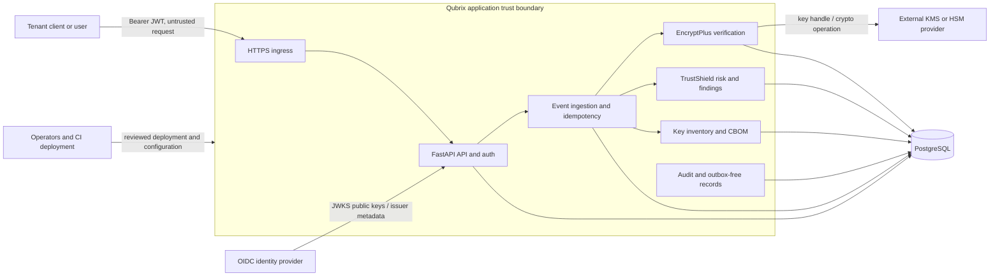

# Qubrix architecture

## Scope and system context

Qubrix is a synchronous, multi-tenant modular monolith with two product capabilities:

- **TrustShield AI** applies deterministic, versioned risk rules and decision bands. No LLM or broker is part of v1.
- **EncryptPlus** verifies signed-event envelopes, manages key metadata and lifecycle, and presents cryptographic inventory and CBOM data. Cryptographic operations use a configured provider and vetted libraries; Qubrix does not implement primitives.

The trust-boundary diagram shows the intended production topology. Components outside the application trust boundary are untrusted until authenticated and validated. PostgreSQL is trusted for persistence but is not a key vault.



**Trust boundaries**

1. **Caller to ingress:** TLS-protected transport does not make caller data trustworthy. Validate JWT issuer, audience, expiry, signature, and required role/scope; validate every request schema and enforce per-organization authorization.
2. **OIDC provider to resource server:** Discovery/JWKS data is accepted only for the configured issuer over authenticated TLS. Cache keys under bounded refresh rules; reject unknown signing keys or unavailable verification rather than accepting an unverified token.
3. **Application to PostgreSQL:** use a restricted service identity and TLS where available. All tenant-owned reads and writes are organization-scoped, even when IDs are unguessable. Keep credentials out of source, database rows, logs, and responses.
4. **Application to key provider:** a narrow provider interface accepts key identifiers and cryptographic operation inputs. Private key material remains within the provider boundary and is never persisted or returned by Qubrix. Provider errors fail closed.
5. **Operations and deployment:** restrict production configuration and migration access. CI artifacts, logs, and support access must not contain secrets or sensitive event payloads.

## Modules and responsibilities

| Module | Responsibility | Must not do |
|---|---|---|
| API and identity | Versioned HTTP contracts, RFC 9457 errors, OIDC JWT/JWKS validation, identity context construction | Accept organization, actor, or roles from request bodies |
| Tenant authorization | Organization scoping, role/scope permission checks, object-level authorization | Treat an identifier or valid signature as authorization |
| Event ingestion | Schema validation, safe normalization, idempotency, transaction coordination | Persist full card numbers or plaintext sensitive payloads |
| EncryptPlus verification | Resolve tenant-owned key metadata, call vetted verification/provider APIs, record status | Implement cryptographic primitives, downgrade algorithms, or infer legitimacy from a valid signature |
| TrustShield risk | Persist versioned input facts and score, apply fixed decision bands and hard overrides | Lower risk because a signature is valid; discard verification status |
| Findings | Durable, independently addressable security findings, including each failed/unavailable verification and replay | Hide a failed verification inside only a score or response |
| Key inventory and CBOM | Store public/non-secret metadata, lifecycle state, provenance, and component inventory | Store secret keys or claim a CBOM proves runtime safety |
| Persistence and migrations | PostgreSQL repositories, tenant-scoped constraints, Alembic schema evolution | Rely on application filters alone where database constraints can enforce invariants |
| Audit and rate limiting | Append-only security-relevant audit records and atomic tenant/principal request budgets | Log credentials, signatures, plaintext, or full sensitive payloads |

## Deployment topology

Deploy one FastAPI application artifact behind a TLS-terminating ingress, with one PostgreSQL database and a separately operated OIDC provider and key provider (KMS/HSM). The application may have multiple stateless replicas; PostgreSQL coordinates durable state, idempotency, replay detection, and rate budgets. No message broker or background worker is required for v1. A request either completes its synchronous work or returns an explicit failure; do not report durable success for work that was not committed.

Production secrets and connection URLs are injected through the deployment secret/configuration mechanism. In local development and tests the database URLs are supplied as `DATABASE_URL` and `TEST_DATABASE_URL`; values must never be printed. Docker is not available on the development host, so container build, compose, and image scanning remain CI-only verification items until actually run in CI.

## Event ingestion request lifecycle

The server derives organization and actor from the validated identity. `received_at` is assigned by the server. The client cannot supply or override either value, the verification result, risk score, finding state, or decision.

```mermaid
sequenceDiagram
    participant C as Client
    participant A as API/Auth
    participant I as Ingestion
    participant P as PostgreSQL
    participant K as Key provider
    participant V as Verification
    participant R as Risk/Findings
    C->>A: POST /api/v1/events + JWT + Idempotency-Key
    A->>A: Validate JWT, role/scope, schema, tenant context
    A->>I: Validated request + identity context
    I->>I: Canonical request fingerprint
    I->>P: Begin transaction; claim tenant/actor/route/key
    alt Existing key, same fingerprint
        P-->>I: Previously committed response
        I-->>C: Original result (replayed HTTP response)
    else Existing key, different fingerprint
        P-->>I: Fingerprint conflict
        I-->>C: 409 idempotency_conflict
    else New idempotency key
        I->>I: Assign organization_id and received_at
        I->>P: Check tenant-scoped replay identity
        opt Signed event
            I->>K: Verify using tenant key handle and declared algorithm
            K-->>I: VALID, INVALID, UNKNOWN_KEY, or unavailable
            I->>P: Persist verification status
        end
        I->>R: Persist risk inputs, score, decision, findings
        I->>P: Persist event and original response; commit atomically
        P-->>I: Commit
        I-->>C: 201 created with event, verification, risk and finding refs
    end
```

The idempotency record and result are committed with the event. Replay detection is a separate security control: a new HTTP idempotency key does not make a previously observed signed-event nonce or event identity fresh. Concurrent requests are serialized by database uniqueness/transaction handling. A provider or database failure before commit returns an explicit error and no success-shaped fallback. A verification failure that is successfully recorded commits its own finding; inability to durably record that finding prevents a successful response.

## Key-management boundary

Persist only provider name/configuration reference, tenant-scoped key identifier, public metadata, algorithm identifier, fingerprint, lifecycle state, and timestamps. A provider adapter performs supported operations using an opaque handle. Secret/private key bytes do not cross into Qubrix persistence, logs, or HTTP responses. Key operations are allowlisted; unknown or unavailable keys produce explicit verification status and a finding. Algorithm selection is explicit and policy-checked; no fallback or downgrade occurs. The API exposes lifecycle and inventory operations, not secret export or decrypt-by-default. ADMIN does not have decrypt permission by default.

## Failure modes and expected behavior

| Failure | Expected behavior |
|---|---|
| Missing, malformed, expired, wrong-audience, or unverifiable JWT | Reject request; do not construct a trusted tenant/actor context |
| OIDC/JWKS unavailable or token key unknown | Fail authentication closed; return a retryable service error when appropriate, never bypass signature validation |
| Invalid signature | Record `INVALID`, persist a separate finding, and impose at least `VERIFY`; never accept it as valid |
| Unknown verification key | Record `UNKNOWN_KEY`, persist a separate finding, and impose at least `VERIFY` |
| Verification provider unavailable/timeout | Record `UNAVAILABLE` and a separate finding when the result can be durably recorded; otherwise fail the request without claiming success |
| Replayed event identity/nonce | Persist a replay finding and decision `FLAG`, independent of signature validity |
| PostgreSQL unavailable or transaction failure | Return an explicit service failure; do not acknowledge an event as persisted |
| Idempotency key reused with different request | Return 409 `idempotency_conflict`; do not overwrite the original result |
| Rate-limit store unavailable | Fail closed for protected writes; return explicit service failure, not an unmetered success |
| Unsupported or disallowed algorithm | Reject/fail closed; do not silently select another algorithm |
| Malformed or oversized payload | Reject before expensive cryptographic work; do not log payload contents |
| Risk calculation/configuration error | Fail explicitly; do not invent an approval or silently default to a lower-risk decision |

These are design expectations, not evidence of regulatory compliance.
