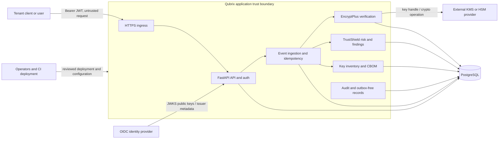
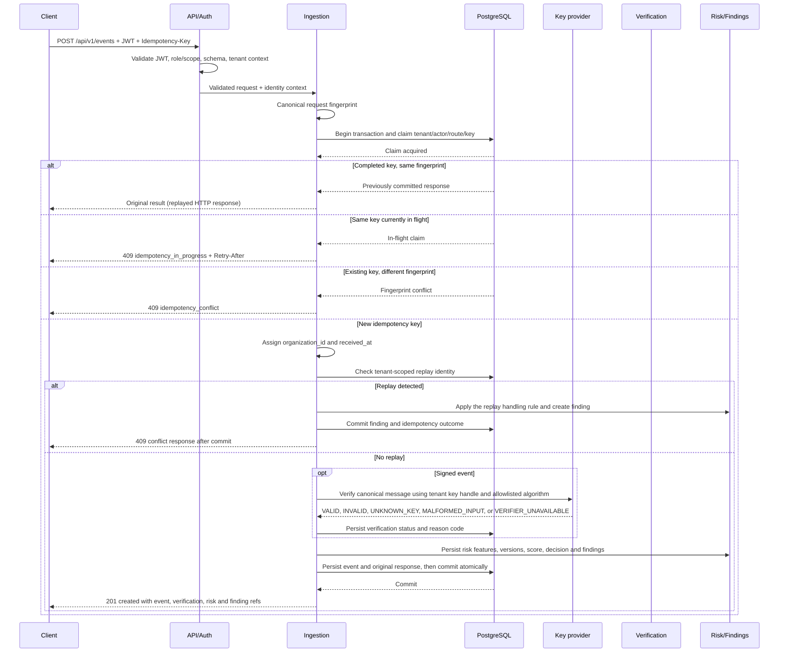

# Qubrix architecture

## Scope and system context

Qubrix is a synchronous, multi-tenant modular monolith with two product capabilities:

- **TrustShield AI** applies deterministic, versioned risk rules and decision bands to bounded, typed event attributes and recorded verification/replay facts. No LLM or broker is part of v1.
- **EncryptPlus** verifies signed-event envelopes, performs provider-backed encryption/decryption for explicitly authorized service identities, manages key metadata/lifecycle, and presents cryptographic inventory and CBOM data. Cryptographic operations use a configured provider and vetted libraries; Qubrix does not implement primitives.

The trust-boundary diagram shows the intended production topology. Components outside the application trust boundary are untrusted until authenticated and validated. PostgreSQL is trusted for persistence but is not a key vault.

**Trust boundaries**

1. **Caller to ingress:** TLS-protected transport does not make caller data trustworthy. Validate JWT issuer, audience, expiry, signature, and required role/scope; validate every request schema and enforce per-organization authorization.
2. **OIDC provider to resource server:** Discovery/JWKS data is accepted only for the configured issuer over authenticated TLS. Cache keys under bounded refresh rules; reject unknown signing keys or unavailable verification rather than accepting an unverified token. The validated JWT has `sub` for actor, `organization_id` for tenant mapping, `roles` as an array, and `scope` as a space-delimited OAuth scope string. Tenant/role administration remains in the IdP/provisioning plane.
3. **Application to PostgreSQL:** use a restricted service identity and TLS where available. All tenant-owned reads and writes are organization-scoped, even when IDs are unguessable. Keep credentials out of source, database rows, logs, and responses.
4. **Application to key provider:** a narrow provider interface accepts key identifiers and cryptographic operation inputs. Private key material remains within the provider boundary and is never persisted or returned by Qubrix. Provider errors fail closed.
5. **Operations and deployment:** restrict production configuration and migration access. CI artifacts, logs, and support access must not contain secrets or sensitive event payloads.

## Modules and responsibilities

| Module | Responsibility | Must not do |
|---|---|---|
| API and identity | Versioned HTTP contracts, RFC 9457 errors, OIDC JWT/JWKS validation, identity context construction | Accept organization, actor, or roles from request bodies |
| Tenant authorization | Organization scoping, role/scope permission checks, object-level authorization | Treat an identifier or valid signature as authorization |
| Event ingestion | Discriminated typed event schemas (`extra=forbid`), bounded attributes, safe normalization, idempotency, server timestamps/tenant, transaction coordination | Accept PAN/plaintext identity; accept client identity or outcome fields; mutate key state from `KEY_LIFECYCLE_CHANGE` reports |
| EncryptPlus verification and crypto | Canonical signed-message construction, explicit algorithm allowlist, provider-backed verify/encrypt/decrypt, durable result/finding | Implement primitives, downgrade algorithms, infer legitimacy from a valid signature, or expose decrypt to a human role by default |
| TrustShield risk | Persist bounded feature snapshot and versioned assessment/reasons; score, apply decision bands and hard floors, append analyst reviews | Lower score because signature is valid; discard verification state; permit an override to bypass a hard floor |
| Findings | Durable, independently addressable security findings, including each failed/unavailable verification and replay | Hide a failed verification inside only a score or response |
| Key inventory and CBOM | Store public/non-secret metadata, lifecycle state, provenance, and component inventory | Store secret keys or claim a CBOM proves runtime safety |
| Persistence and migrations | PostgreSQL repositories, tenant-scoped constraints, Alembic schema evolution | Rely on application filters alone where database constraints can enforce invariants |
| Audit and rate limiting | Append-only security-relevant audit records and atomic tenant/principal request budgets | Log credentials, signatures, plaintext, or full sensitive payloads |

## Deployment topology

Deploy one FastAPI application artifact behind a TLS-terminating ingress, with one PostgreSQL database and a separately operated OIDC provider and key provider (KMS/HSM). The application may have multiple stateless replicas; PostgreSQL coordinates durable state, idempotency, replay detection, and rate budgets. No message broker or background worker is required for v1. A request either completes its synchronous work or returns an explicit failure; do not report durable success for work that was not committed.

Production secrets and connection URLs are injected through the deployment secret/configuration mechanism; production settings ignore `.env`. The canonical database URL names are `DATABASE_URL`, `TEST_DATABASE_URL`, `RUNTIME_DATABASE_URL`, and `RUNTIME_TEST_DATABASE_URL`, with no `QUBRIX_`-prefixed aliases. All other settings use `QUBRIX_` names. Production runtime database access must use a password-protected non-owner `qubrix_runtime` URL with TLS and a non-test database; owner and test URLs are rejected by production settings. `QUBRIX_APP_SECRET` is reserved for HMAC-SHA-256 pagination-cursor signing, not JWT signing or encryption, and must be rotated through deployment secrets with all replicas updated together. Docker is not available on the development host, so container build, compose, and image scanning remain CI-only verification items until actually run in CI.

## Event ingestion request lifecycle

The server derives organization and actor from the validated identity. `received_at` is assigned by the server. The client cannot supply or override either value, the verification result, risk score, finding state, assessment, or decision. Each request has `schema_version` and `correlation_id`; every response has a server `request_id`. Event `attributes` are type-specific, bounded, typed, and reject unknown fields.

Idempotency records, committed event results, and required findings are durable before a response is sent. Same-key in-flight requests return 409 `idempotency_in_progress`; missing required keys return 400 `idempotency_key_required`. Signed messages require a nonce. Concurrent claims are protected by database uniqueness. A provider or database failure before commit returns an explicit error and no success-shaped fallback. Each verification failure status commits its own finding; inability to durably record it prevents success.

### Replay handling

A replay is either an already accepted `(organization_id, event_id)` submitted with a new idempotency key (`409 event_id_conflict`) or reuse of a signed nonce (`409 replay_detected`). Each distinct conflicting attempt commits one finding linked to the original event and a separate `FLAG` attempt assessment, and returns both references. It never creates/replaces the original event or modifies its assessment. A retry with the same idempotency key returns the stored conflict response without another finding. Commit the finding and idempotency outcome atomically before sending 409; if that commit fails, return 503 and do not send a 409 implying the finding was persisted.

JSON canonicalization and v1 number handling are defined in [ADR-0010](./adr/0010-json-canonicalization-and-numbers.md). Deployment-dependent retention, replay freshness, rate quotas, and production KMS/HSM selection remain **needs owner decision** as tracked in [ADR-0011](./adr/0011-open-decisions.md).

TrustShield features are derived only from allowlisted event attributes and recorded facts: transaction amount/currency/channel/country/device token/auth method; login method/outcome/channel/country/device token/factor count; signed-message purpose/payload size; key-lifecycle reported action/status/source. Monetary features use integer minor units; all numeric signed-event attributes are bounded integers and contain no floating-point values. Additional features include event-time age, replay state, and verification status/reason. Raw identity, PAN, credentials, plaintext payloads, and signature bytes are excluded. Persist an immutable, bounded feature snapshot with `feature_version`, `model_version`, `ruleset_version`, `reason_codes`, and `overrides_applied`. Score 0-39 maps to APPROVE, 40-69 VERIFY, 70-100 FLAG. Invalid/unknown-key force at least VERIFY; replay forces FLAG. A valid signature never reduces score.

## Key-management boundary

Persist only provider name/configuration reference, tenant-scoped key identifier, public metadata, algorithm identifier, fingerprint, lifecycle state, and timestamps. A provider adapter performs supported operations using an opaque handle. Secret/private key bytes do not cross into Qubrix persistence, logs, or HTTP responses. Decrypt returns transient plaintext only to a SERVICE workload with explicit `crypto:decrypt`; no human role has that grant by default. Unknown keys are `UNKNOWN_KEY`; disabled/revoked keys are `INVALID` with reason `KEY_DISABLED`/`KEY_REVOKED`; malformed inputs are `MALFORMED_INPUT`; provider outage is `VERIFIER_UNAVAILABLE`. None can be reported as `VALID`. Algorithm selection is explicit and policy-checked; no fallback or downgrade occurs.

## Failure modes and expected behavior

| Failure | Expected behavior |
|---|---|
| Missing, malformed, expired, wrong-audience, or unverifiable JWT | Reject request; do not construct a trusted tenant/actor context |
| OIDC/JWKS unavailable or token key unknown | Fail authentication closed; return a retryable service error when appropriate, never bypass signature validation |
| Invalid signature or disabled/revoked key | Record `INVALID` (reason `KEY_DISABLED` or `KEY_REVOKED` for known lifecycle state), persist a separate finding, impose at least `VERIFY`; never accept it as valid |
| Unknown verification key | Record `UNKNOWN_KEY`, persist a separate finding, and impose at least `VERIFY` |
| Malformed signed input | Record `MALFORMED_INPUT` and a separate finding; never classify as valid |
| Verification provider unavailable/timeout | Record `VERIFIER_UNAVAILABLE` and a separate finding when the result can be durably recorded; otherwise fail the request without claiming success |
| PostgreSQL unavailable or transaction failure | Return an explicit service failure; do not acknowledge an event as persisted |
| Idempotency key reused with different request | Return 409 `idempotency_conflict`; do not overwrite the original result |
| Signature without nonce | Return 400 `nonce_required`; do not verify or accept the message |
| `KEY_LIFECYCLE_CHANGE` event ingested | Record event only; do not mutate key state |
| Cursor authentication failure or limit over max | Return 400 `invalid_cursor` or `limit_exceeded`; never bypass cursor tenant binding or silently clamp |
| Rate-limit store unavailable | Fail closed for protected writes; return explicit service failure, not an unmetered success |
| Unsupported or disallowed algorithm | Reject/fail closed; do not silently select another algorithm |
| Malformed or oversized payload | Reject before expensive cryptographic work; do not log payload contents |
| Risk calculation/configuration error | Fail explicitly; do not invent an approval or silently default to a lower-risk decision |

These are design expectations, not evidence of regulatory compliance.
