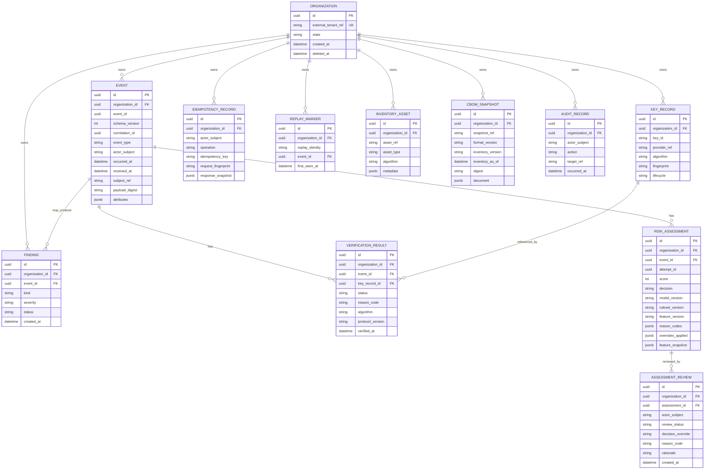

# Data model

## Entity relationship

Every tenant-owned entity is scoped to one organization. The diagram omits routine timestamps and redacted metadata for legibility. Primary and foreign keys are UUIDs unless explicitly noted.

## Keys and constraints

- `organization.id` is the tenant primary key. `external_tenant_ref` is unique and mapped only by trusted provisioning/identity configuration, not by caller-supplied event data.
- Every tenant-owned row carries `organization_id NOT NULL`. References between tenant rows use composite foreign keys `(organization_id, referenced_id)` so a row cannot point across tenants even if application authorization regresses.
- `event`: unique `(organization_id, event_id)`. Replay/conflict responses and finding durability are defined once in [architecture.md](./architecture.md#replay-handling) and [api-contracts.md](./api-contracts.md#common-contract). A conflict finding references the original event; any `FLAG` attempt assessment is distinct and never modifies the original assessment. Index `(organization_id, received_at DESC, id DESC)` for cursor pagination and `(organization_id, actor_subject, received_at DESC)` for audit/query use. Check `event_type` against the four v1 event types and `schema_version`; `attributes` are JSONB validated against the event-type-specific bounded, typed schema (`extra=forbid`). `received_at` and `organization_id` are assigned by the server; `correlation_id` is trace metadata.
- `key_record`: unique `(organization_id, key_id)` and `(organization_id, provider_ref)` where provider references are unique per tenant; index `(organization_id, lifecycle)`. Store metadata and opaque provider references only, not private/secret key bytes.
- `verification_result`: composite FK to event and optional key record; index `(organization_id, event_id, verified_at DESC)`. Check status against `VALID`, `INVALID`, `UNKNOWN_KEY`, `MALFORMED_INPUT`, `VERIFIER_UNAVAILABLE`; store bounded reason code, algorithm, and protocol version. A known disabled or revoked key is `INVALID` with reason `KEY_DISABLED` or `KEY_REVOKED`, never `VALID`. Do not overwrite prior attempts. Every outcome other than `VALID` creates its own finding.
- `risk_assessment`: composite FK to event when the event was accepted; `attempt_id` distinguishes a rejected duplicate event-ID attempt and is unique within organization for a request attempt. Multiple immutable assessments for the same event/model are permitted when needed to preserve replay attempts. Persist score, final decision, reason codes, model/ruleset/feature versions, overrides, and a bounded typed feature snapshot. Index `(organization_id, event_id, created_at DESC)` and `(organization_id, decision, created_at DESC)`. No PAN, plaintext identity, credential, signature bytes, or sensitive payload is a feature.
- `finding`: composite FK to event when event-associated; index `(organization_id, status, created_at DESC)` and `(organization_id, event_id, kind)`. Multiple distinct finding kinds for one event are allowed, including a replay and verification failure together.
- `idempotency_record`: unique `(organization_id, actor_subject, operation, idempotency_key)`; state distinguishes in-flight from completed and stores fingerprint/status/redacted response for completed requests; index expiry/created timestamp for cleanup. Request fingerprints use canonical validated business inputs but exclude trace-only `correlation_id` and server-assigned fields. Same key while in-flight returns `409 idempotency_in_progress`; same key with changed fingerprint returns `409 idempotency_conflict`. Response snapshot contains only the original redacted API result.
- `replay_marker`: unique `(organization_id, replay_identity)`; index `(organization_id, first_seen_at DESC)`. Replay identity is derived from validated event identity/nonce according to event type; it is not the HTTP idempotency key. Keep the original event and marker on conflict; each distinct conflict finding references that original event, and any `FLAG` attempt assessment is separate from the original assessment. Do not create another accepted event row for an event-ID or signed-nonce conflict.
- `assessment_review`: composite FK to assessment; index `(organization_id, assessment_id, created_at DESC)`. Append-only analyst review/override rows include identity-derived actor, status, optional decision override, reason code, and rationale. They never rewrite the original score/assessment. Overrides cannot lower replay or invalid/unknown-key floors.
- `inventory_asset`: unique `(organization_id, asset_ref)`; index `(organization_id, asset_type, asset_ref)`.
- `cbom_snapshot`: unique `(organization_id, snapshot_ref)`; index `(organization_id, created_at DESC)`. Generation reads only the authenticated tenant's inventory and records its inventory version/as-of time, provenance, and digest. Store bounded validated metadata; reject secrets and plaintext sensitive payloads.
- `audit_record`: index `(organization_id, occurred_at DESC, id DESC)` and `(organization_id, actor_subject, occurred_at DESC)`. Application role cannot update/delete audit facts.

All unique identities include `organization_id`, preventing global uniqueness collisions from becoming a cross-tenant information channel. Enforce length, enum, and numeric-range constraints in both application validation and the database where practical. Event attributes are typed, event-discriminated, size-bounded JSONB with `extra=forbid`; common attributes include no plaintext identity data or PAN. JSONB feature snapshots are schema-validated, size-bounded, non-sensitive facts. `correlation_id` is not an authorization key.

## Deletion and retention

Organization deletion is a soft-delete/suspension that blocks new access and writes; it does not cascade-delete event, finding, verification, risk, or audit evidence. Referential deletion is restricted for audit/security records. A separately authorized purge process may irreversibly delete tenant data only after the tenant retention policy permits it and legal holds are cleared; purge actions themselves are audited. Key references are disabled before any provider-side destruction workflow.

No universal retention duration is prescribed here. Before production, configure and document retention periods per entity/data class and jurisdiction/contract, and ensure idempotency/replay cleanup does not outlive or undercut the required replay-protection window. This design makes no regulatory compliance claim.

## Transaction boundaries

1. **Event ingestion:** require an idempotency key; one PostgreSQL transaction claims it, inserts a non-conflicting event with server identity/timestamp, claims tenant-scoped replay identity, inserts verification outcome, risk assessment and required findings, and stores the redacted original response. Missing key is `400 idempotency_key_required`; same key in flight is `409 idempotency_in_progress`; changed body under the same key is `409 idempotency_conflict`. Replay outcomes and conflict-finding durability are defined once in [architecture.md](./architecture.md#replay-handling) and [api-contracts.md](./api-contracts.md#common-contract); commit finding and idempotency response atomically before sending 409.
2. **Provider operation:** provider calls cannot participate in a PostgreSQL transaction. Treat them as explicit external steps. Do not report a key rotation/disable as complete until the provider result and local lifecycle/audit update are confirmed; reconcile uncertain outcomes explicitly rather than silently retrying a non-idempotent provider action.
3. **Audit and key lifecycle:** persist state change and corresponding audit record in the same database transaction. Application database permissions prevent ordinary mutation of audit rows.
4. **Reads:** every query includes authenticated `organization_id`; pagination cursors bind organization, filters, and stable ordering and are HMAC-SHA-256 signed. Cursor keys are stored in the approved secret provider, never in the database or logs.
5. **Rate limiting:** perform atomic budget updates in PostgreSQL so application replicas share a limit without a broker or local bypass.
