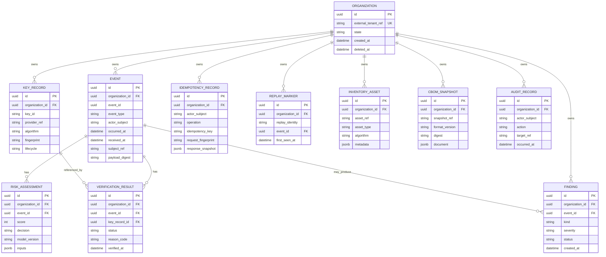

# Data model

## Entity relationship

Every tenant-owned entity is scoped to one organization. The diagram omits routine timestamps and redacted metadata for legibility. Primary and foreign keys are UUIDs unless explicitly noted.

## Keys and constraints

- `organization.id` is the tenant primary key. `external_tenant_ref` is unique and mapped only by trusted provisioning/identity configuration, not by caller-supplied event data.
- Every tenant-owned row carries `organization_id NOT NULL`. References between tenant rows use composite foreign keys `(organization_id, referenced_id)` so a row cannot point across tenants even if application authorization regresses.
- `event`: `event_id` is a caller-supplied event identity and is not unique because each replay attempt is retained as a distinct event row with a server-generated `id`. Index `(organization_id, event_id)` for replay lookup and `(organization_id, received_at DESC, id DESC)` for cursor pagination; index `(organization_id, actor_subject, received_at DESC)` for audit/query use. Check `event_type` against the four v1 event types. `received_at` and `organization_id` are assigned by the server.
- `key_record`: unique `(organization_id, key_id)` and `(organization_id, provider_ref)` where provider references are unique per tenant; index `(organization_id, lifecycle)`. Store metadata and opaque provider references only, not private/secret key bytes.
- `verification_result`: composite FK to event and optional key record; index `(organization_id, event_id, verified_at DESC)`. Store explicit status and bounded reason code. Do not overwrite prior attempts.
- `risk_assessment`: composite FK to event; unique `(organization_id, event_id, model_version)` for one immutable result per version; index `(organization_id, decision, created_at DESC)` as needed for findings/risk queries. Risk inputs contain only approved, non-sensitive facts.
- `finding`: composite FK to event when event-associated; index `(organization_id, status, created_at DESC)` and `(organization_id, event_id, kind)`. Multiple distinct finding kinds for one event are allowed, including a replay and verification failure together.
- `idempotency_record`: unique `(organization_id, actor_subject, operation, idempotency_key)`; index expiry/created timestamp for cleanup. Request fingerprints use canonical validated inputs. Response snapshot contains only the original redacted API result.
- `replay_marker`: unique `(organization_id, replay_identity)`; index `(organization_id, first_seen_at DESC)`. Replay identity is derived from validated event identity/nonce according to event type; it is not the HTTP idempotency key. Keep the original marker on conflict; persist the replay attempt as its own event and attach the replay finding to that attempt.
- `inventory_asset`: unique `(organization_id, asset_ref)`; index `(organization_id, asset_type, asset_ref)`.
- `cbom_snapshot`: unique `(organization_id, snapshot_ref)`; index `(organization_id, created_at DESC)`. Store bounded validated metadata, provenance, and digest; reject secrets and plaintext sensitive payloads.
- `audit_record`: index `(organization_id, occurred_at DESC, id DESC)` and `(organization_id, actor_subject, occurred_at DESC)`. Application role cannot update/delete audit facts.

All unique identities include `organization_id`, preventing global uniqueness collisions from becoming a cross-tenant information channel. Enforce length, enum, and numeric-range constraints in both application validation and the database where practical. JSONB is restricted to schema-validated, size-bounded non-sensitive facts.

## Deletion and retention

Organization deletion is a soft-delete/suspension that blocks new access and writes; it does not cascade-delete event, finding, verification, risk, or audit evidence. Referential deletion is restricted for audit/security records. A separately authorized purge process may irreversibly delete tenant data only after the tenant retention policy permits it and legal holds are cleared; purge actions themselves are audited. Key references are disabled before any provider-side destruction workflow.

No universal retention duration is prescribed here. Before production, configure and document retention periods per entity/data class and jurisdiction/contract, and ensure idempotency/replay cleanup does not outlive or undercut the required replay-protection window. This design makes no regulatory compliance claim.

## Transaction boundaries

1. **Event ingestion:** one PostgreSQL transaction claims the idempotency key, inserts a distinct event row with server identity/timestamp, attempts to claim its tenant-scoped replay identity, inserts verification outcome, risk assessment and all required findings, and stores the redacted original response. A replay-marker uniqueness conflict leaves the original marker intact and produces a replay finding and `FLAG` decision for the new attempt. Commit before returning success. Idempotency uniqueness conflicts are resolved by reading the committed idempotency record and comparing its fingerprint. If required findings cannot be persisted, do not acknowledge success.
2. **Provider operation:** provider calls cannot participate in a PostgreSQL transaction. Treat them as explicit external steps. Do not report a key rotation/disable as complete until the provider result and local lifecycle/audit update are confirmed; reconcile uncertain outcomes explicitly rather than silently retrying a non-idempotent provider action.
3. **Audit and key lifecycle:** persist state change and corresponding audit record in the same database transaction. Application database permissions prevent ordinary mutation of audit rows.
4. **Reads:** every query includes authenticated `organization_id`; pagination cursors bind organization, filters, and stable ordering.
5. **Rate limiting:** perform atomic budget updates in PostgreSQL so application replicas share a limit without a broker or local bypass.
